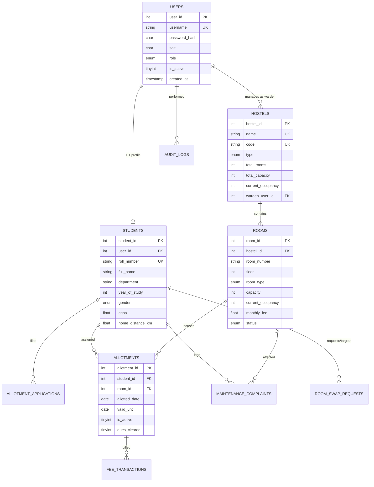

# Architecture Specification: University Dorm Allotment Portal
**Location**: Durgapur, West Bengal  
**Tech Stack**: C, SQL, MySQL / MariaDB (InnoDB), Relational Database Design, SHA-256 Cryptographic Authentication

---

## 1. System Overview

The **University Dorm Allotment Portal** is a high-performance, secure accommodation management system engineered in **C** with a **normalized MySQL relational backend**. Modeled after the residential infrastructure of technological institutions in **Durgapur, West Bengal** (e.g. National Institute of Technology Durgapur), the system streamlines the complete student accommodation lifecycle:
- Secure multi-role authentication (Students, Hall Wardens, Chief Warden / Admin).
- Real-time room availability and bed vacancy tracking.
- Automated merit-priority allocation engine with atomic transactions.
- Peer-to-peer room swap negotiation with gender constraint verification.
- Facility maintenance ticket tracking with resolution velocity monitoring.
- Non-repudiation security audit trail logging.

```
+-----------------------------------------------------------------------------------+
|                                 USER LAYER                                        |
|  [ Student Portal ]          [ Hall Warden Portal ]       [ Chief Warden / Admin ]|
+-----------------------------------------------------------------------------------+
                                        |
+-----------------------------------------------------------------------------------+
|                        APPLICATION & BUSINESS LOGIC (C)                           |
|  +--------------------+  +----------------------+  +---------------------------+  |
|  | Authentication API |  | Allocation Engine    |  | Accommodation Services    |  |
|  | - Salted SHA-256   |  | - Merit Formula      |  | - Room Swap Workflow      |  |
|  | - RBAC Guard       |  | - Atomic Allocations |  | - Maintenance Ticketing   |  |
|  +--------------------+  +----------------------+  +---------------------------+  |
+-----------------------------------------------------------------------------------+
                                        |
+-----------------------------------------------------------------------------------+
|                       DATABASE ADAPTER & REPOSITORY LAYER                         |
|  - Prepared query execution / Sanitization against SQL injection                 |
|  - Dual engine: Native MySQL C API (`libmariadb`) + In-Memory Relational Engine   |
+-----------------------------------------------------------------------------------+
                                        |
+-----------------------------------------------------------------------------------+
|                   3NF NORMALIZED RELATIONAL DATABASE (MySQL)                      |
|  `users` | `students` | `hostels` | `rooms` | `allotments` | `complaints` ...      |
+-----------------------------------------------------------------------------------+
```

---

## 2. Relational Database Design (3NF Normalization)

The database schema is strictly engineered in **Third Normal Form (3NF)** to eliminate anomalies, reduce redundancy, and ensure referential integrity.

### 2.1 Normalization Analysis
1. **First Normal Form (1NF)**:
   - All column values are atomic (e.g., student name, roll number, addresses, and contacts are divided into individual discrete attributes).
   - Each row is uniquely identified by an explicit primary key (`user_id`, `student_id`, `room_id`, `allotment_id`, etc.).
2. **Second Normal Form (2NF)**:
   - There are no partial functional dependencies. In composite tables (like `rooms` where `hostel_id` + `room_number` form a unique key), all non-key attributes (e.g. `capacity`, `monthly_fee`, `status`) functionally depend entirely on the surrogate primary key `room_id`.
3. **Third Normal Form (3NF)**:
   - Every non-prime attribute is non-transitively dependent on the primary key.
   - For instance, student details (name, department, CGPA, distance) are not duplicated inside `allotments` or `allotment_applications`; they reference `student_id`.
   - Hostel warden metadata is linked via foreign key `warden_user_id` rather than embedded inside hostel records.

### 2.2 Entity-Relationship (ER) Schema



### 2.3 Indexing & Performance Optimizations
- `idx_room_availability (hostel_id, status, current_occupancy, capacity)`: Composite index that enables sub-millisecond retrieval of vacant beds during peak allocation rounds.
- `idx_app_status_merit (status, merit_score DESC)`: Index on pending applications allowing the automated allotment engine to stream applicants in strict rank order without requiring costly in-memory file sorts (`filesort`).
- `idx_student_merit (cgpa DESC, home_distance_km DESC)`: Optimizes departmental merit calculations and eligibility reviews.
- `uq_hostel_room (hostel_id, room_number)`: Strict composite uniqueness constraint preventing duplicate room entries per hostel.

---

## 3. Cryptographic Authentication & Security Architecture

### 3.1 Salted SHA-256 Hashing
- Passwords are never stored in plaintext.
- Upon registration or password update, a cryptographically random 32-character hexadecimal salt is generated using `generate_random_salt()`.
- The password and salt are combined with an application-level key:
  $$\text{Hash} = \text{SHA256}(\text{Password} \parallel \text{Salt} \parallel \text{"NIT\_DGP\_DORM\_SALT"})$$
- Verification uses constant-time string comparison (`crypto_sha256.c`) to eliminate timing attacks.

### 3.2 Role-Based Access Control (RBAC) Matrix

| Operation / Feature | Student | Hall Warden | Chief Warden / Admin |
|---------------------|:-------:|:-----------:|:--------------------:|
| Self-Registration & Sign-In | Yes | Yes | Yes |
| View Own Allotment & Roommates | Yes | - | - |
| Apply for Dorm Allotment | Yes | - | - |
| Submit Room Swap Request | Yes | - | - |
| File Maintenance Ticket | Yes | - | - |
| View Hostel Room Matrix | - | Yes (Assigned) | Yes (All Campus) |
| Approve/Reject Room Swaps | - | Yes | Yes |
| Resolve Maintenance Tickets | - | Yes | Yes |
| Execute Automated Allotment Run | - | - | Yes |
| Student Check-Out / Vacating | - | Yes | Yes |
| View Security Audit Logs | - | - | Yes |

---

## 4. Priority-Merit Allocation Algorithm

To allocate campus dorms fairly among thousands of students, the engine uses a transparent, multi-factor scoring formula:

$$\text{Merit Score} = \left(\frac{\text{CGPA}}{10.0} \times 70.0\right) + \left(\frac{\min(\text{Distance}_{\text{km}}, 1000)}{1000.0} \times 20.0\right) + \left(\frac{\text{Year}}{4.0} \times 10.0\right)$$

- **Academic Merit (70%)**: Prioritizes academic performance.
- **Domicile Distance from Durgapur (20%)**: Students residing further away from Durgapur (e.g. outstation students from north-east or distant states) receive priority over local residents.
- **Academic Seniority (10%)**: Final year students preparing for campus placements and thesis projects receive prioritized single or double room allotments.

### 4.1 Atomic Allocation Guarantees
During allocation:
1. `db_begin_transaction()` starts an ACID transaction.
2. The candidate room's vacancy is verified (`current_occupancy < capacity`).
3. An active allotment row is inserted into `allotments`.
4. Room occupancy is incremented, and status transitions from `AVAILABLE` $\to$ `PARTIAL` $\to$ `OCCUPIED`.
5. The application status changes to `ALLOTTED`.
6. `db_commit()` commits all operations atomically. If any constraint fails, `db_rollback()` ensures the room never suffers from partial or double allocation.

---

## 5. Accommodation Management Workflows

### 5.1 Peer-to-Peer Room Swap Workflow
```
[Student A (Room T-101)] ---> Requests Swap with Student B (23CS8045)
                                        |
                        [System Security Checks]
                        - Both students have active allotments?
                        - Gender compatibility check (no cross-gender swaps)?
                                        |
                        [Pending Status in Warden Queue]
                                        |
                 [Warden Reviews & Clicks "Approve"]
                                        |
                 [Atomic DB Transaction Exchanged Rooms]
                 - Student A allotment updated to Target Room
                 - Student B allotment updated to Applicant Room
                 - Status marked "APPROVED"
```

### 5.2 Maintenance Ticketing Workflow
Students residing in active rooms file complaints under 6 discrete categories:
1. Electrical
2. Plumbing
3. Carpentry
4. Cleanliness
5. Network / LAN
6. Other

Wardens review open tickets, assign maintenance crews, and log resolution notes before marking tickets as `RESOLVED`.
